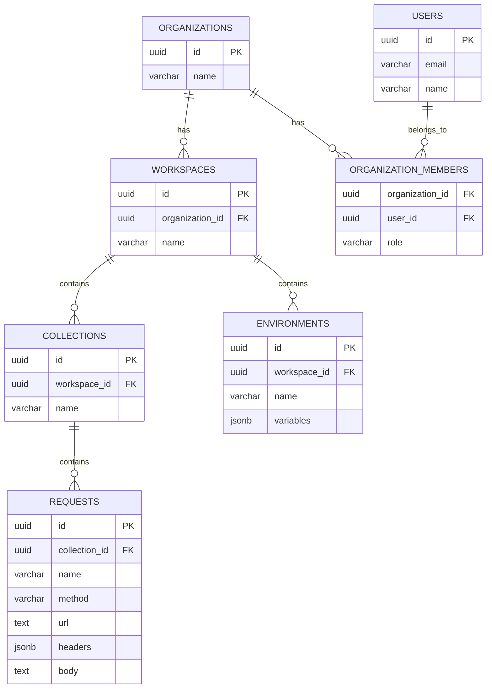

# API Client Database Schema

## Diagram

## Source of truth

The schema is defined by the migrations in `supabase/migrations/`
(`20261111000000_base_schema.sql`). This page summarizes it; if they differ,
the migration wins.

All tables have `created_at` and `updated_at` (`timestamptz`, `updated_at` is
maintained by a trigger). All tables have Row Level Security enabled.

## Tables

### users

Profile row for every `auth.users` entry, created by the `on_auth_user_created` trigger.

- `id`: UUID, Primary Key, references `auth.users(id)`
- `email`: VARCHAR(255), Unique, **nullable** (guests have no email; copied from `auth.users` by `on_auth_user_updated` when a guest connects GitHub; a GitHub account may hide its email, so it can stay null)
- `name`: VARCHAR(255), nullable

### organizations

- `id`: UUID, Primary Key
- `name`: VARCHAR(255)

### organization_members

- `organization_id`: UUID, Foreign Key -> `organizations(id)`
- `user_id`: UUID, Foreign Key -> `users(id)`
- `role`: VARCHAR(50), default `member` (`owner` for the personal organization)

### workspaces

- `id`: UUID, Primary Key
- `organization_id`: UUID, Foreign Key -> `organizations(id)`
- `name`: VARCHAR(255)

### environments

- `id`: UUID, Primary Key
- `workspace_id`: UUID, Foreign Key -> `workspaces(id)`
- `name`: VARCHAR(255)
- `variables`: JSONB, `[{ "key", "value", "secret", "enabled" }]`, default `[]`

### collections

- `id`: UUID, Primary Key
- `workspace_id`: UUID, Foreign Key -> `workspaces(id)`
- `name`: VARCHAR(255)
- `position`: INT, order in the sidebar tree

### requests

- `id`: UUID, Primary Key
- `collection_id`: UUID, Foreign Key -> `collections(id)`
- `name`: VARCHAR(255)
- `method`: VARCHAR(10), default `GET`
- `url`: TEXT
- `params`: JSONB, `[{ "key", "value", "enabled" }]`
- `headers`: JSONB, `[{ "key", "value", "enabled" }]`
- `auth`: JSONB, `{ "type": "none" | "bearer" | "basic" | "apiKey", ... }`
- `body_type`: VARCHAR(30), default `none` (`none`, `json`, `formData`, `urlEncoded`, `raw`)
- `body`: TEXT. The text for `json` / `raw` bodies; for `form-data` / `urlencoded` a JSON-encoded list `[{ "key", "value", "enabled" }]`; null for no body
- `position`: INT, order in the sidebar tree

## Functions

- **`duplicate_collection(source_id, new_name)`** (migration `20261111010000_duplicate_collection.sql`):
  copies a collection and all its requests in one atomic call and returns the
  new `collections` row. It runs as the caller (`security invoker`), so RLS
  decides what can be read and inserted; `anon` cannot execute it.

## Auth bootstrap and RLS

- **`on_auth_user_created`** (after insert on `auth.users`, including anonymous
  sign-ins): inserts the `users` row, a personal `organizations` row,
  an `organization_members` row with role `owner`, and a default workspace
  named "My Workspace".
- **`on_auth_user_updated`**: copies a changed email into `users.email`.
- **Policies:** a user can read and write rows only in organizations they are a
  member of. Membership checks use the `security definer` helpers
  `is_org_member`, `is_workspace_member` and `is_collection_member`.
  `users`, `organizations` and `organization_members` are written only by the
  triggers (clients can read them; `users` and `organizations` can be updated).
  Guests use the `authenticated` role, so they follow the same policies.

## Local development

`supabase db reset` re-runs the migrations and `supabase/seed.sql`, which adds a
dev account (`dev@testpoint.local` / `password123`) with a sample collection and
environment.
